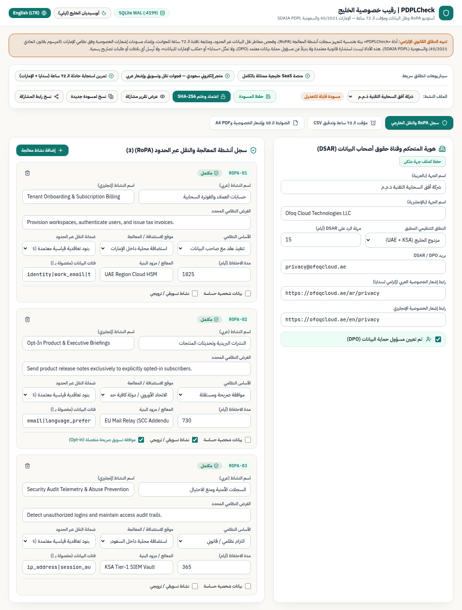
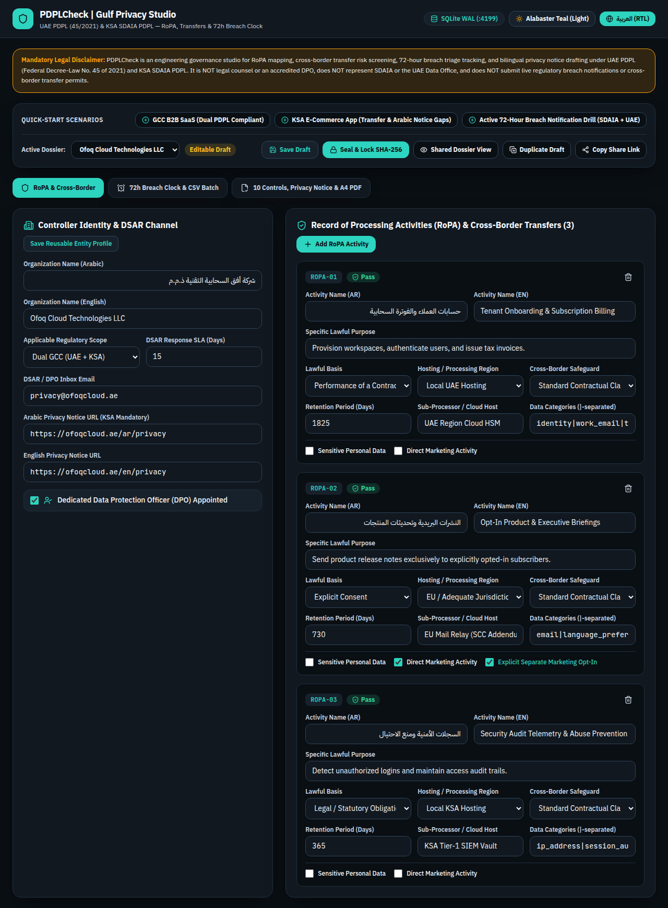
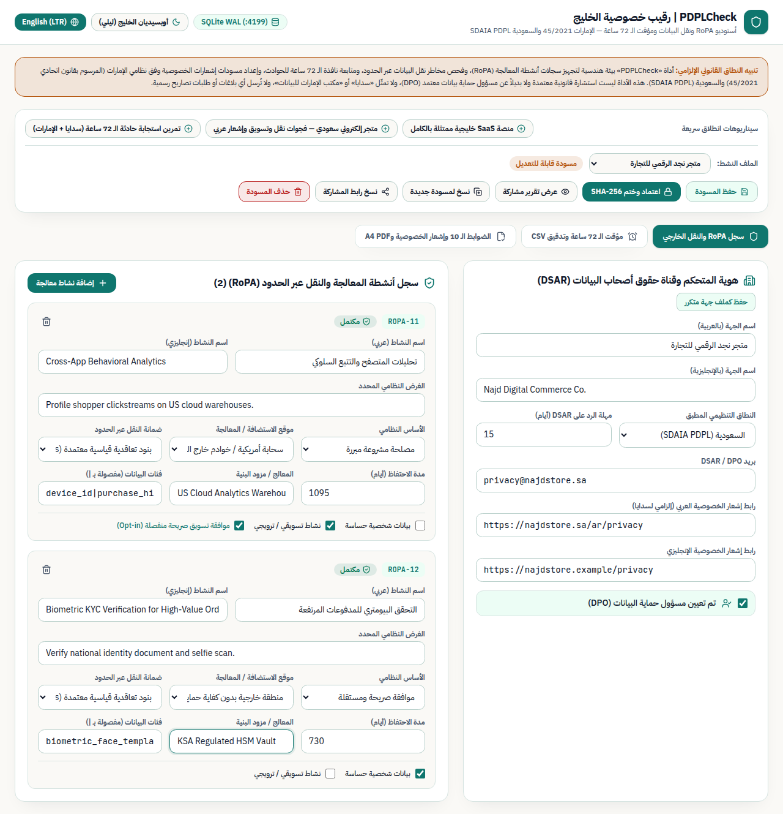
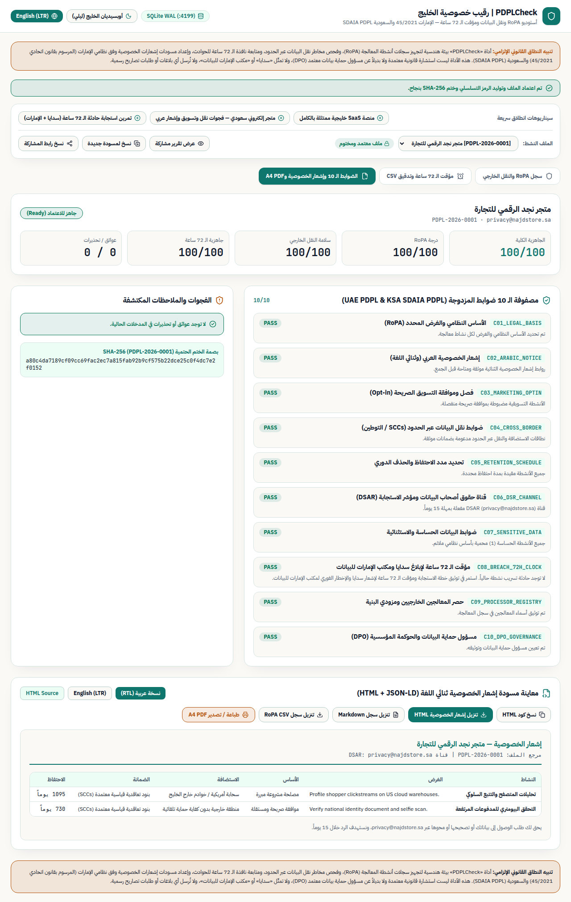
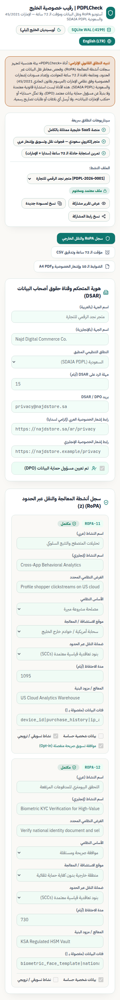
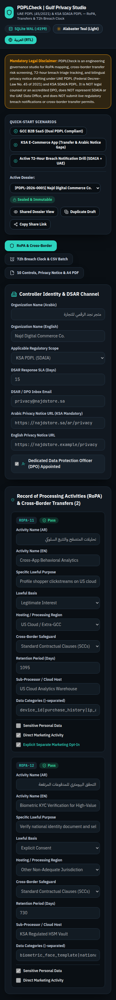

# PDPLCheck | رقيب خصوصية الخليج

[](https://github.com/manea/pdplcheck/actions/workflows/ci.yml)
[](LICENSE)
A **$0, privacy-first** engineering readiness studio for **UAE PDPL (`Federal Decree-Law No. 45 of 2021`)** and **Saudi Arabia PDPL (`SDAIA PDPL`)** — featuring a bilingual (`AR RTL` / `EN LTR`) **Record of Processing Activities (`RoPA`)** & cross-border transfer auditor, a **`72-hour` SDAIA breach triage clock**, an XSS-safe bilingual privacy notice `HTML + JSON-LD` builder, a **10-control matrix**, and deterministic `PDPL-YYYY-0001` `SHA-256` sealing.

> **Mandatory Legal Disclaimer:** PDPLCheck is an engineering governance studio, RoPA mapper, and bilingual privacy notice builder. It is **NOT** legal counsel or an accredited **DPO**, does **NOT** represent **SDAIA** (`سدايا`) or the **UAE Data Office**, and does **NOT** submit live regulatory breach notifications or cross-border transfer permit applications.

---

## Key Capabilities

- **Dual UAE & KSA RoPA & Cross-Border Auditor**:
  - Audits lawful basis alignment, mandatory **Arabic privacy notice URL** before data collection under **KSA SDAIA PDPL**, explicit separate **marketing opt-in consent**, retention day limits, sensitive data handling, and cross-border hosting safeguards (`local_residency` vs `SCCs` vs `none`).
  - Bulk CSV audit & RFC-4180 export (`UTF-8 BOM + CRLF`) with formula-injection neutralization (`=`, `+`, `-`, `@` cells prefixed with `'`).
- **72-Hour SDAIA & UAE Data Office Breach Clock**:
  - Computes elapsed hours, remaining hours toward SDAIA's `72-hour` deadline (`within_72h`, `urgent_under_12h`, `overdue`, `notified_on_time`), and flags regulator vs affected data-subject notice obligations.
- **Bilingual Privacy Notice (`HTML + JSON-LD`) & A4 Dossier**:
  - Generates XSS-safe `AR RTL` and `EN LTR` privacy notices with embedded Schema.org JSON-LD inside a sandboxed preview frame, plus Markdown readiness registers (`C01`–`C10`), atomic `PDPL-YYYY-0001` `SHA-256` sealing, `/r/:slugOrCode` read-only share routes, and **A4 PDF** print reports.
- **Dual Visual Identity**:
  - **Alabaster Teal & Falcon Gold** (Light `AR RTL` default: `#FAF9F6`, `#0F766E`, `#B45309`) & **Gulf Obsidian Slate** (Dark `EN LTR`: `#0A0F14`, `#2DD4BF`).

---


## UI Previews

### Workspace — Arabic RTL (`Alabaster Teal & Falcon Gold`)


### Dual-Script Workspace — English LTR (`Gulf Obsidian Slate Dark`)


### Remediated KSA RoPA & Cross-Border Transfer Safeguards


### Sealed Dual-PDPL Dossier (`PDPL-YYYY-0001`, 10 Controls & Bilingual Notice)


### Mobile Arabic RTL View (`390x844`)


### Mobile English LTR View (`Gulf Obsidian Slate Dark`, `390x844`)


---
## Local Development (`Node 22+`)

```bash
npm install
npm run dev          # Vite frontend (:4200, proxies /api -> :4199)
npm start            # Node 22 + SQLite WAL server (:4199)
npm run typecheck    # Strict TypeScript check
npm test             # Core + Server integration tests (Vitest)
npm run build        # Production static bundle in ./dist
npm run test:e2e     # Real Chrome Playwright E2E tests (:4200)
```

---

## Zero-Budget Deployment Options (`$0/month`)

### Option 1: Cloudflare Workers Static Assets (`wrangler.jsonc`)
All RoPA checks, cross-border validations, 72h breach calculations, bulk CSV audits, bilingual HTML + JSON-LD generation, SHA-256 sealing, and A4 PDF printing run 100% locally in the browser (`localStorage`):

```bash
npm run build
npx wrangler login
npx wrangler deploy
```

### Option 2: Self-Hosted Docker / Node 22 + SQLite WAL

```bash
docker compose up -d --build
# Reverse proxy 127.0.0.1:4199 via deploy/Caddyfile (supports optional BASE_PATH=/pdplcheck)
```

---

## HTTP API Summary (Optional Backend `:4199`)

| Method & Path | Purpose |
| :--- | :--- |
| `GET /api/health` | Service status, version, `basePath`, dossier & profile stats |
| `GET /api/presets` | Dual-PDPL sample scenarios (`gcc-saas-compliant`, `ksa-ecommerce-transfer-gaps`, `breach-72h-triage-drill`) |
| `POST /api/audit-pdpl` | Stateless RoPA, cross-border & 72h breach assessment + HTML / Markdown |
| `POST /api/audit/ropa-csv` | Bulk RoPA CSV validation + formula-safe UTF-8 BOM CSV export |
| `GET/POST/PATCH/DELETE /api/profiles` | Reusable GCC Controller / DPO entity profiles CRUD |
| `GET/POST /api/dossiers` | List & create editable PDPL draft dossiers |
| `GET/PATCH/DELETE /api/dossiers/:id` | Read, update draft, or delete unsealed draft (`409` if locked) |
| `POST /api/dossiers/:id/duplicate` | Clone draft or locked dossier into an editable draft |
| `POST /api/dossiers/:id/finalize` (`or /lock`) | Atomically seal as `PDPL-YYYY-0001` with `SHA-256` digest |
| `GET /api/dossiers/:id/privacy-notice.html` | Download bilingual XSS-safe HTML + JSON-LD privacy notice (`?locale=ar\|en`) |
| `GET /api/dossiers/:id/ropa.md` | Download Markdown RoPA + 10-control readiness dossier (`?locale=ar\|en`) |
| `GET /api/dossiers/:id/export.csv` | Download formula-safe UTF-8 BOM CSV register |
| `GET /api/dossiers/:id/summary` | Concise executive summary (`?locale=ar\|en`) |
| `GET /api/public/reports/:slugOrCode` | Shareable read-only PDPL dossier endpoint with view counter |

## License

MIT
